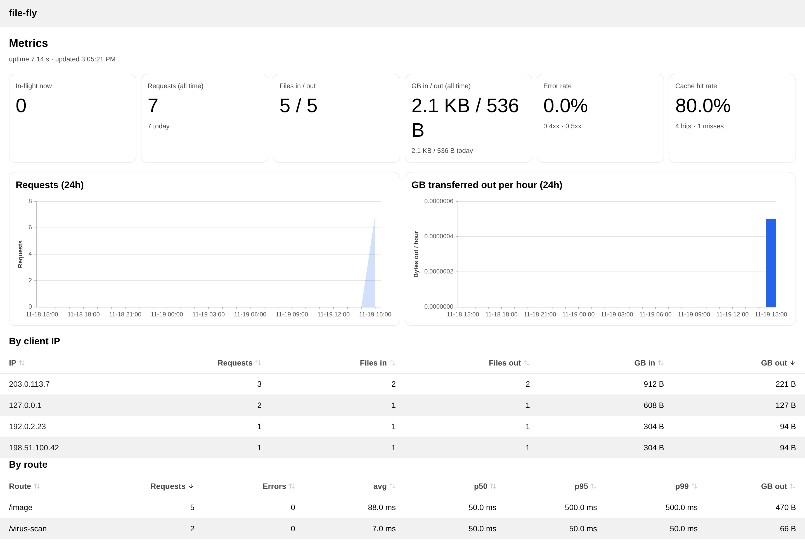
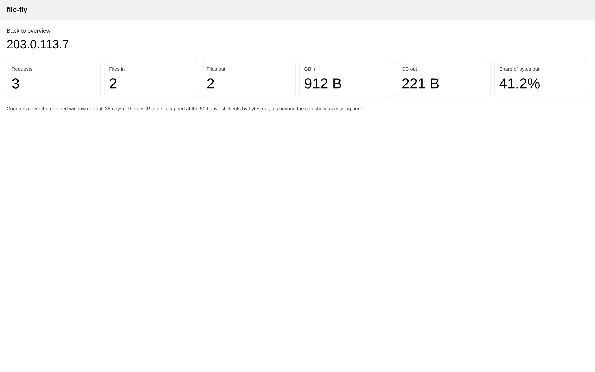

# file-fly

Stream-first file and media processing, on the fly.

`file-fly` is a [NestJS](https://nestjs.com) + [Fastify](https://fastify.dev) service (strict TypeScript, ESM) that accepts media from a raw upload (`POST`) or a remote URL (`GET ?source=…`) and streams the processed result back — the media routes never buffer whole files and never write temporary media files (the document-family binary routes buffer the capped upload by design).

Under the hood: images are processed with [sharp](https://sharp.pixelplumbing.com/) (libvips), audio and video with [node-av](https://github.com/Brooooooklyn/node-av) (FFmpeg), perceptual fingerprints are computed in WebAssembly (PDQ) or through FFmpeg (Chromaprint), and every payload the pipeline parses is scanned with ClamAV first — media routes via `FileScannerInterceptor`, document-family binary routes likewise.

## Repository layout

npm workspaces monorepo:

- `packages/backend` — the NestJS + Fastify media service (this document)
- `packages/dashboard` — the React SPA metrics dashboard
- root — workspaces orchestration (`npm run check`, `start:dev`, …), Docker, docs

## Features

- **Image processing** — resize / crop / rotate / flip, blur, sharpen, median, normalize, greyscale, trim, negate, tint, format conversion via sharp. `GET|POST /image`
- **OCR** — text extraction from images with tesseract.js (bounded worker pool). `GET|POST /image/ocr`
- **Audio processing** — transcode and filter (trim, fade, gain, speed, normalize, compress, denoise) via FFmpeg. `GET|POST /audio`
- **Video processing** — transcode (h264 / vp9 / av1), scale, fps, crf, trim, denoise, deinterlace, grayscale, normalize, sharpen; frame screenshots served as `multipart/mixed`. `GET|POST /video`, `GET|POST /video/audio`, `GET|POST /video/screenshot`
- **Perceptual fingerprints ("DNA")** — PDQ for images, Chromaprint for audio, frame-sequence PDQ for video. For deduplication and triage, never identity. `GET|POST /{image,audio,video}/dna`
- **Documents, spreadsheets and office formats** — CSV/XLSX/DOCX/PPTX/PDF build, extract and metadata (JSON schemas, ClamAV-scanned binary uploads). `POST /csv/{build,extract,metadata}`, `POST /xlsx/…`, `POST /docx/…`, `POST /pptx/…`, `POST /pdf/…`
- **Fonts** — metadata, glyph inventory, OpenType shaping and minimal-for-embedding subsetting. `POST /font/{metadata,extract,shape,subset}`
- **3D models** — GLB metadata, structural extraction, meshopt/draco optimization and container conversion. `POST /model/{metadata,extract,optimize,convert}`
- **Metadata & statistics** — container/stream metadata and channel-level statistics for image, audio and video. `GET|POST /{image,audio,video}/metadata`, `GET|POST /{image,audio,video}/stats`
- **Malware scanning** — every media route and every document-family binary route is scanned with ClamAV (fail-closed) before processing starts; `GET|POST /virus-scan` reports the verdict, `GET|POST /signature` reports the detected file signature.
- **Streaming output cache** — filesystem-backed, atomic `tmp → rename` writes, TTL + LRU size cap, background janitor.
- **Usage metrics** — per-IP request counts, files and bytes in/out, in-flight gauge, latency percentiles (p50/p95/p99), cache hit rate and scan verdicts, stored in SQLite (`node:sqlite`) with hourly rollups and a retention sweep.
- **Metrics dashboard** — a React SPA served at `/` by the backend (Vite + Astryx + TanStack Router/Query/Charts), polling `GET /metrics` every 5 seconds. See [docs/metrics.md](docs/metrics.md).
- **OpenAPI** — Swagger UI at `/swagger` (JSON at `/swagger/json`).

## How it works

```text
request (raw body upload or ?source=<url> download)
  → FileScannerInterceptor   ClamAV INSTREAM scan, fail-closed
                             (infected → 422, daemon down → 503, body too big → 413)
  → FileParserInterceptor    file-type signature probe + cache key
  → signature interceptor    per-media-type checks (payload mismatch → 4xx)
  → service / worker thread  sharp or node-av pipeline
  → StreamCache              cache hit streams straight from disk
  → chunked response with backpressure
```

- No full in-memory buffering (media routes): input streams through the interceptors into worker threads; output streams back chunked with backpressure. The document-family binary routes buffer the upload in memory (≤ 25 MiB) to parse it.
- No temporary media files; the one exception is the screenshot probe, which pipes stdin to a self-deleting `CACHE_DIR/<uuid>.tmp` (0o600) in a `finally`. A crashed writer can only leave orphaned `*.tmp` files behind, which the janitor removes after `CACHE_TMP_MAX_AGE_MS`.
- Cache keys are a SHA-256 of the NUL-joined base key / filename / worker payload; entries are evicted by TTL (`CACHE_TTL_MS`) and by total size (`CACHE_MAX_BYTES`, LRU).
- Fingerprint (`/dna`) responses are served through the same cache.

## Metrics and the dashboard

Every completed request is counted, keyed by client IP (the socket peer, or the first `X-Forwarded-For` hop when `TRUST_PROXY=true` — only behind a proxy you control):

- request count, files in/out (uploads/downloads count as a file in, streamed responses as a file out)
- bytes in/out (GB), 4xx/5xx counts
- latency distribution with p50/p95/p99 per route
- cache hit/miss rate, antivirus verdicts (clean/infected/blocked)
- live in-flight gauge (never persisted)

Aggregates live in a SQLite database at `METRICS_DIR` (default `./metrics/metrics.db`, deliberately outside `CACHE_DIR`): hourly per-route counters, daily per-IP counters, hourly latency histogram buckets. Writes are coalesced in memory and flushed in one transaction on a timer — never on the request path. Buckets older than `METRICS_RETENTION_DAYS` (default 35) are swept. See [docs/metrics.md](docs/metrics.md) for the schema and payload.

`GET /metrics` returns one JSON payload with everything the dashboard needs. In production, requests to `/metrics` require `Authorization: Bearer $METRICS_TOKEN` (503 without it, never public by accident); in development the endpoint is open with a boot warning. The dashboard at `/` renders it; `/ip/<addr>` deep-links into per-client stats.

| Overview | Per-client drill-down |
|----------|----------------------|
|  |  |

Screenshots are rendered by headless Playwright in the dashboard e2e (`npm run test:e2e -w file-fly-dashboard`): it boots the built backend with a throwaway metrics store and a fake clamd, seeds demo traffic from synthetic documentation IPs, and rewrites `docs/screenshots/*.png`. Regenerate and commit them deliberately when the UI changes; the `uptime`/`updated` labels always change between runs.

```bash
curl -s http://localhost:3000/metrics | head -c 400
curl -s http://localhost:3000/health
```

## API overview

All routes accept `GET` (media fetched server-side from `?source=<url>`; client headers are forwarded to the remote host) and `POST` (raw body — set `content-length > 0` and a `content-type` supported by `file-type`, or `application/octet-stream`). `GET` answers `200`, `POST` answers `201`.

| Route | Description |
| --- | --- |
| `GET\|POST /image` | Process an image. Query: `width`, `height`, `fit`, `rotate`, `flip`, `flop`, `format`, `quality`, `blur`, `sharpen`, `median`, `normalize`, `greyscale`, `trim`, `negate`, `tint`, `background`, `withoutEnlargement`, `withoutReduction`, `threshold`, … |
| `GET\|POST /image/metadata` | sharp metadata as JSON |
| `GET\|POST /image/stats` | sharp channel statistics as JSON |
| `GET\|POST /image/ocr` | OCR text extraction. Query: `lang` — ISO 639-2 codes separated by `+` (URL-encoded, e.g. `eng%2Bfra`) or `,` (e.g. `eng,fra`); up to four codes; default `eng` |
| `GET\|POST /image/dna` | PDQ fingerprint — `{ algorithm, version, env, hash, quality }` |
| `GET\|POST /audio` | Process audio. Query: `format` (default `mp3`), `codec`, `bitrate`, `sampleRate`, `channels`, `gain`, `speed`, `fadeIn`, `fadeOut`, `trimStart`, `trimEnd`, `normalize`, `compress`, `denoise` |
| `GET\|POST /audio/metadata` | Audio stream metadata as JSON |
| `GET\|POST /audio/stats` | Audio stream statistics as JSON |
| `GET\|POST /audio/dna` | Chromaprint fingerprint — `{ algorithm, version, env, hash, length }` |
| `GET\|POST /video` | Process video. Query: `format` (default `mp4`, fragmented), `codec` (`h264`, `vp9`, `av1`), `crf`, `bitrate`, `preset`, `fps`, `width`, `height`, `rotate`, `flip`, `flop`, `trimStart`, `trimEnd`, `denoise`, `deinterlace`, `grayscale`, `normalize`, `sharpen`, `audioCodec`, `audioBitrate`, `audioNormalize`, … |
| `GET\|POST /video/audio` | Extract and stream audio from a video. Query: `format` (`mp3` default, `ogg`, `adts`, `flac`, …), `codec` unavailable, `bitrate`, `channels`, `sampleRate`, `gain`, `normalize`, … |
| `GET\|POST /video/screenshot` | Frame capture. Required query `frames=0,1.5,9` (up to 50, seconds) → `multipart/mixed`, one part per frame |
| `GET\|POST /video/metadata` | Video stream metadata as JSON |
| `GET\|POST /video/stats` | Video stream statistics as JSON |
| `GET\|POST /video/dna` | Frame-sequence PDQ fingerprint — `{ algorithm, version, env, fps, count, frames[] }` |
| `GET\|POST /signature` | Detected file signature — `{ ext, mime }` |
| `GET\|POST /virus-scan` | ClamAV verdict — `{ isInfected, viruses }` (answers `503` when ClamAV is not configured; infected payloads are rejected with `422` before the handler runs) |
| `GET /health` | Liveness probe — `{ status, uptimeSeconds, timestamp }` |
| `GET /metrics` | Metrics payload for the dashboard; bearer-token gated in production (`METRICS_TOKEN`, open in development) |
| `POST /csv/build` | Records → CSV. Body: `{ records: [{ … }], options?: { delimiter, header, escape_formulas … } }` |
| `POST /csv/extract` | CSV → JSON records. Query: `columns`, `delimiter`, `cast`, `cast_date`, `trim`, `maxRows` |
| `POST /csv/metadata` | CSV census: rows/columns/delimiter/per-column types. Query: `maxRows` |
| `POST /xlsx/build` | JSON → .xlsx. Sheets with rows (objects or arrays), cols, merges, autofilter, visibility, workbook props / defined names |
| `POST /xlsx/extract` | .xlsx → records for one sheet. Query: `sheet`, `header`, `raw` |
| `POST /xlsx/metadata` | Workbook + per-sheet metadata: dims, typed census, merges, defined names, props. Query: `maxCells` |
| `POST /docx/build` | JSON → .docx (paragraphs, tables, images, TOC, hyperlinks, foot/endnotes, comments). Body: `{ sections, metadata?, … }` |
| `POST /docx/extract` | .docx → structure (paragraphs, tables, images, hyperlinks, fields, notes) |
| `POST /docx/metadata` | docProps/core.xml + app.xml merged |
| `POST /pptx/build` | JSON → .pptx. Body: `{ layout?, theme?, metadata?, slides: [{ elements }] }` |
| `POST /pptx/extract` | .pptx → slide tree (text, images, shapes, tables, charts, notes) |
| `POST /pptx/metadata` | docProps/core.xml + app.xml merged (slide count …) |
| `POST /pdf/build` | JSON → .pdf (text/line/rect/ellipse/image/table/fields/pageNumber, WinAnsi or embedded fonts) |
| `POST /pdf/extract` | .pdf → text + info dict (`unpdf`/`pdfjs`) |
| `POST /pdf/metadata` | Same info dict + derived facts (encrypted?, tagged?, AcroForm?) |
| `POST /font/metadata` | Font metrics, fsType embedding bits, feature inventory, variation axes. Query: `font` (collection member) |
| `POST /font/extract` | Per-glyph inventory (id, name, code points, advance, bbox, marks). Query: `limit` |
| `POST /font/shape` | OpenType shaping of `text` with `script`/`language`/`direction`/`features` |
| `POST /font/subset` | Minimal sfnt for PDF embedding (no cmap). Header `x-font-subset: pdf-embed` |
| `POST /model/metadata` | GLB asset/extensions/bounds/counts |
| `POST /model/extract` | GLB scene tree, meshes (vertices/triangles), materials, textures, animations, skins |
| `POST /model/optimize` | Dedup→prune→weld→simplify?→compress (meshopt/draco/none) in a worker. Query: `compress`, `simplify`, `weld` |
| `POST /model/convert` | GLB ↔ self-contained glTF JSON (data-URI inlined resources). Query: `to=glb\|gltf` |
| `GET /swagger` | Swagger UI |

## Quick start

```bash
npm ci --ignore-scripts
npm run start:dev        # Nest watch mode on http://localhost:3000
```

The dashboard dev server (with hot reload and an API proxy):

```bash
npm run dev -w file-fly-dashboard   # Vite on http://localhost:5173, proxies /metrics and API paths to :3000
```

Upload a file for processing:

```bash
# Resize + re-encode an image on the fly
curl -X POST --data-binary @photo.jpg \
     -H 'content-type: image/jpeg' \
     'http://localhost:3000/image?width=800&format=webp' \
     -o out.webp

# Transcode a video to WebM (VP9)
curl -X POST --data-binary @clip.mp4 \
     -H 'content-type: video/mp4' \
     'http://localhost:3000/video?format=webm&codec=vp9' \
     -o out.webm

# OCR an uploaded scan (English + French)
curl -X POST --data-binary @scan.png \
     -H 'content-type: image/png' \
     'http://localhost:3000/image/ocr?lang=eng%2Bfra'

# Detect the signature / scan for malware
curl -X POST --data-binary @file.bin -H 'content-type: application/octet-stream' \
     http://localhost:3000/signature
curl -X POST --data-binary @file.bin -H 'content-type: application/octet-stream' \
     http://localhost:3000/virus-scan
```

Or let the server fetch the media itself (client headers are forwarded — only use `source=` with trusted URLs):

```bash
curl 'http://localhost:3000/image?source=https%3A%2F%2Fexample.com%2Fphoto.jpg&format=webp' \
     -o out.webp
```

## Authentication

The app implements HTTP basic auth as a perimeter. The implementation now
delegates to `nest-basic-auth@1.0.0`, which runs as a guard inside the
Fastify `onRequest` hook. It is **opt-in and disabled by default**: it
engages only when both `AUTH_USERNAME` and `AUTH_PASSWORD` are set (setting
just one fails boot).

When enabled, **every route except `/health`** requires the credential on
**every request**, presented as two plain headers — not as the standard
`Authorization` header:

```bash
curl -H "x-auth-username: alice" -H "x-auth-password: s3cret" \
     http://localhost:3000/metrics
```

- Missing, incomplete or wrong credentials get `401` (a wrong password gets a
  constant-time digest comparison). `401` responses now carry
  `WWW-Authenticate: Basic realm="file-fly"` (the one deliberate contract
  change); the body keeps the header-pair shapes below. This remains a
  header-pair contract for API clients, not a browser SSO flow.
- Missing or incomplete pair body:
  `{"message":"Missing or bad formatted authorization header","statusCode":401}`.
- Wrong pair body:
  `{"error":"Unauthorized","message":"Invalid credentials","statusCode":401}`.
- A client-sent `Authorization` header is never honored.
- `GET /health` stays open so the Docker `HEALTHCHECK` and orchestrators can
  probe without credentials.
- The perimeter runs as a fastify `onRequest` hook, so unauthenticated
  uploads are rejected before body limit checks, virus scanning or workers.
- When the perimeter is disabled, the app behaves exactly as before — the
  `METRICS_TOKEN` rules for `/metrics` are unchanged. When it is enabled,
  `/metrics` sits behind the same perimeter; the existing `METRICS_TOKEN`
  bearer check still applies underneath (in production, `/metrics` answers
  `503` unless `METRICS_TOKEN` is also set).
- **Browser caveat:** browsers cannot set custom headers on plain navigation,
  so the React dashboard (and Swagger at `/swagger`) are not usable from a
  stock browser session behind the perimeter. Put the app behind a proxy that
  injects `x-auth-username`/`x-auth-password` (nginx, Traefik, a gateway), or
  drive it as an API. Every response the SPA needs is beneath `/metrics` and
  the same-origin document — a proxy that adds the pair solves both.
- Credentials are compared via SHA-256 digests with `crypto.timingSafeEqual`,
  so response time does not leak credential length.

## Observability (OpenTelemetry)

OpenTelemetry is **opt-in and disabled by default**: the SDK is never even
constructed unless an OTLP traces endpoint is set.

| Variable | Default | Meaning |
| --- | --- | --- |
| `OTEL_TRACE_EXPORTER_URL` | unset | OTLP/HTTP traces endpoint, e.g. `http://collector:4318/v1/traces`; the standard `OTEL_EXPORTER_OTLP_TRACES_ENDPOINT` is also honored. Unset ⇒ no telemetry at all |
| `OTEL_METRICS_PORT` | `9464` | Prometheus host-metrics exposition port (only when telemetry is enabled) |

When enabled, `src/app.tracing.ts` starts a `NodeSDK` **before** NestFactory,
so Fastify plugin registration is captured: W3C + B3 + baggage propagation,
batched OTLP exporter, `FastifyOtelInstrumentation` (per-request and lifecycle
hook spans, `ignorePaths: '/health'`), Node auto-instrumentations
(`http`, `nestjs-core`, `pino` (trace ids in logs), `undici` (`source=`
downloads), `pg`, `runtime-node`), and host metrics on the Prometheus exporter
(`http://localhost:9464/metrics` — `target_info{service_name="file-fly-backend"}`
plus `nodejs_eventloop_*`, v8 heap and process metrics).
Spans from unauthenticated requests (401s) are recorded too.

This is independent of the built-in JSON `/metrics` endpoint (SQLite counters,
served to the dashboard): `/metrics` stays the operational dashboard feed; the
OTel exporter is the collector feed. Nest's SIGTERM hook
(`OtelShutdownService` in `app.module.ts`) flushes pending spans on shutdown.

The dashboard SPA ships with a browser tracer (`packages/dashboard/src/telemetry.ts`):
active only in production builds with `VITE_OTEL_OTLP_ENDPOINT` set (e.g.
`VITE_OTEL_OTLP_ENDPOINT=http://localhost:4318`). It uses
`WebTracerProvider` + zone context + W3C propagation, so the dashboard's own
fetches (`/metrics` polls) carry `traceparent` to the backend. Development and
unit-test builds never load it.

Notes and limits:

- `instrumentation-fs` is off (OTel default); the media pipeline's file
  traffic would drown the collector otherwise.
- Worker threads (`packages/backend/src/resources/*/worker/`) are opaque to
  OTel: spans do not cross `worker_threads` boundaries, so per-transcode
  timing inside workers is not traced (would need manual `traceparent`
  injection into `workerData`).
- Browsers cannot reach the SPA unless you serve it on the same origin as the
  backend (it is) or a proxy that lets it through — telemetry headers are
  same-origin and need no CORS entries; cross-origin setups must add
  `traceparent`/`tracestate`/`baggage` to the allowed headers.
- The liveness probe `/health` produces no spans.

```bash
OTEL_TRACE_EXPORTER_URL=http://localhost:4318/v1/traces npm run start
# ...
curl -s http://localhost:9464/metrics | head     # host metrics (Prometheus)
curl -s http://localhost:3000/metrics | head    # JSON metrics (in-process)
```

## Docker

Development stack (watch-mode app + dashboard + ClamAV with bundled signature databases):

```bash
docker compose -f docker-compose.development.yml up --build
# app on http://localhost:3000; dashboard on http://localhost:5173 (proxies to the app);
# clamd reachable on the compose network (3310), not published
```

Production image (multi-stage, `node:24-bookworm-slim`, non-root `node` user, cache volume at `/data/cache`, metrics volume at `/data/metrics`, dashboard baked in and served at `/`):

```bash
docker build -t file-fly .
docker run -p 3000:3000 -v file-fly-cache:/data/cache -v file-fly-metrics:/data/metrics \
           -e NODE_ENV=production \
           -e CLAMAV_HOST=clamav -e CLAMAV_PORT=3310 \
           -e METRICS_TOKEN=change-me \
           file-fly
```

## Configuration

All configuration is via environment variables. Values are validated with zod at boot; blank strings are treated as unset, invalid values fall back to defaults, and `NODE_ENV` must be `development` or `production`. Production enables restrictive security headers, CSRF protection and CORS (from `CORS_ORIGIN`).

| Variable | Default | Meaning |
| --- | --- | --- |
| `NODE_ENV` | — (required) | `development` or `production` |
| `PORT` | `3000` | HTTP port |
| `AUTH_USERNAME` | unset | Basic-auth perimeter username; both or neither with `AUTH_PASSWORD`. Unset ⇒ perimeter disabled |
| `AUTH_PASSWORD` | unset | Basic-auth perimeter password; both or neither with `AUTH_USERNAME`. Unset ⇒ perimeter disabled. Clients present the pair as `x-auth-username` / `x-auth-password` headers on every request (never `Authorization`) |
| `CORS_ORIGIN` | unset | Comma-separated allowed origins in production (URLs), e.g. `https://app.example.com,https://dash.example.com`; a bare single URL is accepted too |
| `CACHE_DIR` | `./cache` (`/data/cache` in Docker) | Cache root; created at startup |
| `CACHE_TTL_MS` | `86400000` (24 h) | Entries unused for longer are evicted |
| `CACHE_MAX_BYTES` | `2147483648` (2 GiB) | Total cache size cap; oldest-used entries evicted first |
| `CACHE_SWEEP_INTERVAL_MS` | `600000` (10 min) | Cache janitor sweep interval |
| `CACHE_TMP_MAX_AGE_MS` | `3600000` (1 h) | Orphaned `*.tmp` files older than this are removed |
| `CLAMAV_HOST` | unset | clamd host. **Unset ⇒ virus scanning is skipped** (one warning); production deployments must set it |
| `CLAMAV_PORT` | unset | clamd port; must be set together with `CLAMAV_HOST` |
| `CLAMAV_TIMEOUT_MS` | `60000` | clamd socket connect timeout |
| `CLAMAV_MAX_BYTES` | `26214400` (25 MiB) | Larger bodies are rejected `413` before scanning; also the hard cap for unsized media streams and remote downloads |
| `EGRESS_ALLOWLIST` | unset | Comma-separated bare hostnames the `source=` download path may fetch (dotted suffixes allowed for subdomains); when EGRESS_ALLOWLIST is unset, loopback/private/link-local/CGNAT literals are refused; when set, the allowlist is authoritative. Scheme is restricted to http/https; client credentials (authorization, cookie, x-*) are never forwarded to the remote origin |
| `TESSERACT_DIR` | `<CACHE_DIR>/tesseract` | tesseract.js language data directory |
| `TESSERACT_POOL_SIZE` | `2` | OCR worker pool size (1–8) |
| `TESSERACT_PRELOAD` | `eng` | Languages preloaded at startup |
| `TESSERACT_RECYCLE_JOBS` | `500` | Recycle an OCR worker after N jobs |
| `TESSERACT_TIMEOUT_MS` | `60000` | Per-recognition timeout |
| `FILE_HASH_HEADER_SIZE` | `65536` | Bytes hashed (SHA-512 prefix) for the upload cache key when no `x-file-hash` request header is sent |
| `LOG_LEVEL` | unset | pino log level (`fatal`, `error`, `warn`, `info`, `debug`, `trace`); unset = `info` in production, `debug` otherwise |
| `METRICS_DIR` | `./metrics` (`/data/metrics` in Docker) | Directory holding `metrics.db` (SQLite); kept outside `CACHE_DIR` on purpose |
| `METRICS_TOKEN` | unset | Bearer token for `GET /metrics`. Production refuses the route without it (503); development is open |
| `METRICS_RETENTION_DAYS` | `35` | Days of hourly buckets to keep per route/histogram and daily per-IP buckets |
| `METRICS_FLUSH_INTERVAL_MS` | `1000` | Flush interval for the in-memory metrics delta buffer |
| `DASHBOARD_DIR` | `packages/dashboard/dist` (`/app/dashboard` in Docker) | Static root of the prebuilt dashboard; missing dir = dashboard not served |
| `OTEL_TRACE_EXPORTER_URL` | unset | OTLP/HTTP traces endpoint; unset (and `OTEL_EXPORTER_OTLP_TRACES_ENDPOINT` unset) ⇒ OpenTelemetry fully disabled |
| `OTEL_METRICS_PORT` | `9464` | Prometheus host-metrics exposition port; only bound when telemetry is enabled |
| `TRUST_PROXY` | `false` | Honor `X-Forwarded-For` for `request.ip`; set only behind a proxy you control |

## Testing

```bash
npm run test        # unit tests (vitest, serial), both workspaces
npm run test:e2e    # build + e2e tests (fake clamd fixture)
npm run test:e2e -w file-fly-dashboard  # headless-chromium dashboard e2e; refreshes docs/screenshots/
npm run test:cov    # unit tests with coverage
npm run test:perf   # opt-in micro-benchmarks (tinybench)
npm run test:mem    # opt-in memory-regression specs (--expose-gc)
npm run check       # typecheck + lint + build + unit & e2e tests + knip
```

Unit specs match `**/*.spec.ts` (dashboard: `**/*.spec.tsx`); e2e specs match `**/*.e2e-spec.ts`. Test files run serially (`fileParallelism: false`); real-worker smoke tests use fixtures under `packages/backend/assets/`; generated output goes under `packages/backend/test/results/`. The dashboard also has a Playwright screenshot e2e (`packages/dashboard/test/e2e/`) — it runs via `npm run test:e2e -w file-fly-dashboard`, rebuilds the backend and SPA, and refreshes `docs/screenshots/`. It is not part of `npm run check`.

## Linting

The root flat config uses the pinned `@stackrb/eslint-config@0.1.0` with targets `node`
and `react` and `nodeVersion` set to `>=24.0.0`. The package applies Playwright rules to
all test files; the config scopes that partial to `packages/dashboard/test/e2e` so
Vitest specs keep their own Vitest rules, with no Playwright rule disabled. The package's
browser target is applied to dashboard code for browser globals and Node feature checks.
The only hand-written rule-offs in the flat config are two narrow file-scoped exceptions for values that cannot change without breaking a contract: `unicorn/no-null` on the Fastify callback, XLSX wire, clamd verdict and worker cache-key tag files, and `security/detect-non-literal-fs-filename` on the code generator CLI.

Generated docs, test results, and the generated router file
(`packages/dashboard/src/routeTree.gen.ts`) stay ignored, alongside the package defaults
(`node_modules`, `dist`, `build`, `coverage`, `cache`, dotfiles and `package-lock.json`). The gate runs
`eslint . --fix --cache --max-warnings=0` with zero warnings.

## Documentation

Deep-dives live in `docs/`:

- [docs/dna.md](docs/dna.md) — perceptual fingerprints: endpoints, pipelines, comparison recipes, security notes
- [docs/ocr.md](docs/ocr.md) — OCR pipeline, query parameters, limits
- [docs/antivirus.md](docs/antivirus.md) — ClamAV integration, fail-closed behaviour, EICAR testing
- [docs/metrics.md](docs/metrics.md) — metrics: schema, definitions, payload, security posture
- [docs/documents.md](docs/documents.md) — document/spreadsheet/font/GLB endpoints: payloads, limits, fixture notes
- [docs/performance.md](docs/performance.md) — benchmark and memory-regression suites

## Media streaming (audio / video)

Supported output formats: `webm`, `matroska`, `mpegts`, `mp3`, `ogg`, `adts`, `flac`, and fragmented `mp4`. Plain `mp4`, `mov`, and `wav` output is rejected. Source media is streamed through node-av's demuxer, decoders, filters, encoders, and muxer, and the response uses chunked transfer encoding with backpressure.

Hard limits:

- No full input or output buffering (media routes).
- No temporary media files (except the self-cleaning screenshot probe noted above).
- Plain `mp4` / `mov` input with a trailing `moov` atom is rejected with a 4xx error.
- Codec/container pairings are validated before streaming.
- Worker input probing is bounded to 5MB.
- Jobs abort on client disconnect or timeout; native resources are released when FFmpeg exits.
- `UV_THREADPOOL_SIZE` should be raised when running many concurrent jobs; concurrency must be capped by the libuv thread pool.

## License

Private — the package declares `UNLICENSED` (see `package.json`).
